# Testes do CRUD no Postman

Aluno: Gabriel Max Ferreira Rodrigues
Código de pessoa: 1595154

## 1. Rota POST (Criação de produtos)

**Teste 1 - Cadastro do produto com meu código de aluno (1595154)**
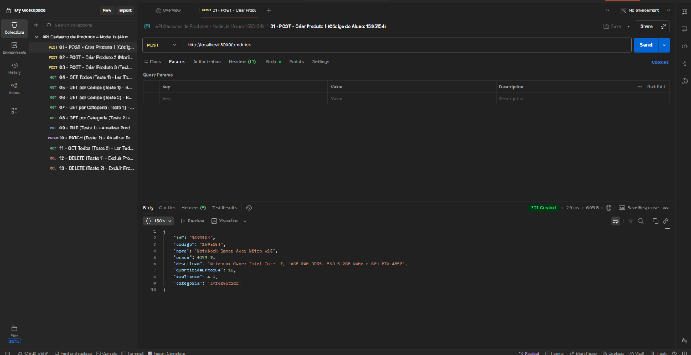
Nessa requisição foi usado o método POST na rota `http://localhost:3000/produtos` para cadastrar o primeiro produto (Notebook Gamer Acer Nitro V15) usando o meu código de aluno `1595154`. A API retornou status 201 Created, mostrando que os dados foram salvos no banco.

**Teste 2 - Cadastro do segundo produto (204810)**
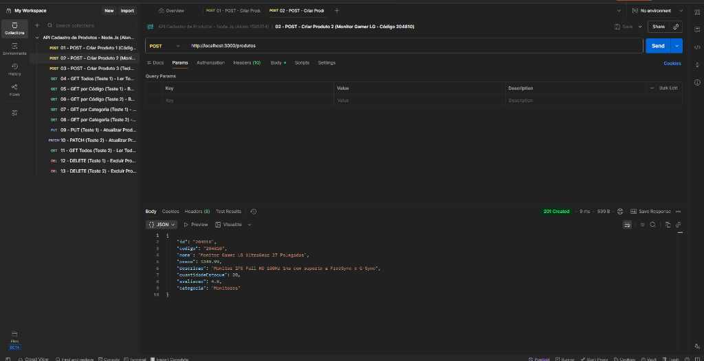
Aqui foi feito outro POST na rota `/produtos` para cadastrar o segundo produto (Monitor Gamer LG UltraGear, código `204810`) na categoria Monitores. O retorno também foi 201 Created com os dados salvos.

**Teste 3 - Cadastro do terceiro produto (309120)**
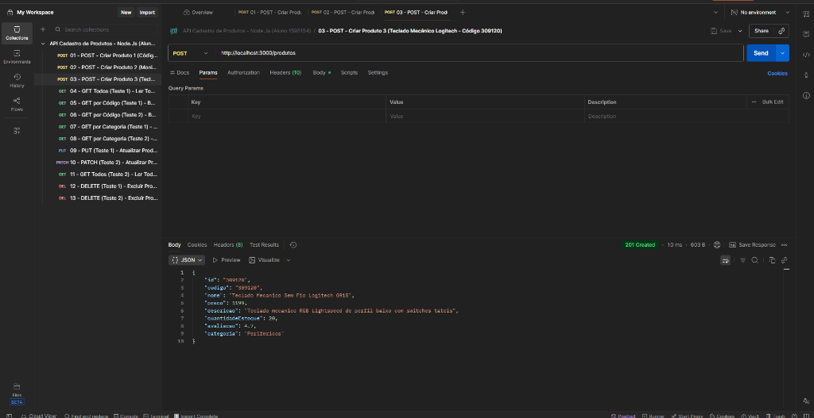
Cadastro de mais um produto via POST (Teclado Mecânico Logitech G915, código `309120`, categoria Perifericos) para usar nos testes de filtro e exclusão, retornando 201 Created.

## 2. Rota GET (Leitura de todos os dados do banco)

**Teste 1 - Listagem de todos os produtos cadastrados**
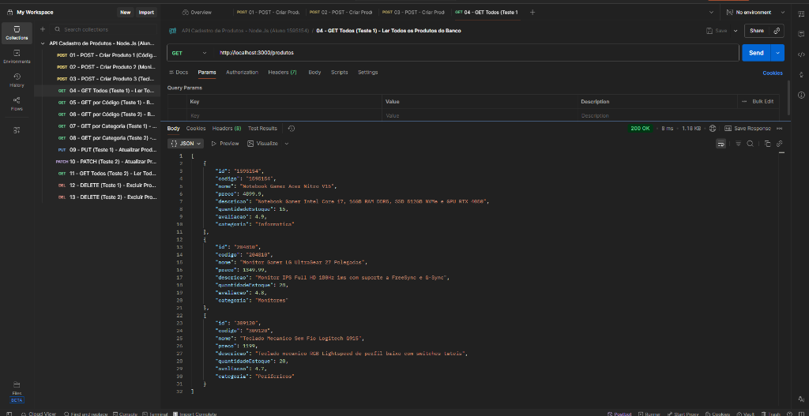
Requisição GET em `http://localhost:3000/produtos` para buscar todos os produtos salvos no banco. A API retornou status 200 OK com a lista contendo o produto do meu código (`1595154`) e os outros dois produtos criados.

**Teste 2 - Listagem geral após as atualizações**
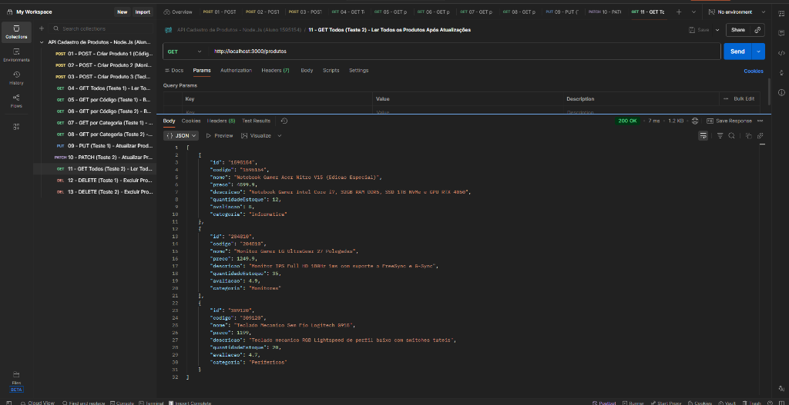
Segunda consulta GET na rota `/produtos` feita depois de editar os registros, retornando status 200 OK e confirmando que os novos valores de preço e estoque ficaram salvos no banco.

## 3. Rota GET por código do produto

**Teste 1 - Busca pelo código 1595154**
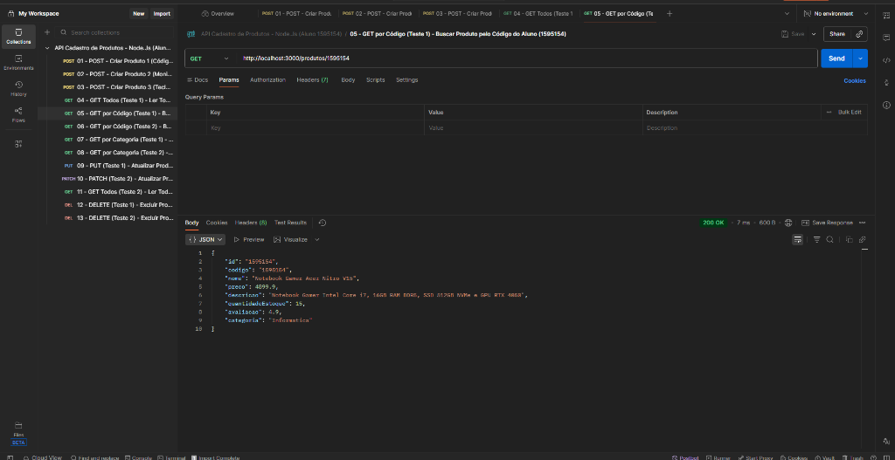
Consulta GET na rota `http://localhost:3000/produtos/1595154` buscando especificamente pelo meu código de aluno. A API encontrou o registro e retornou 200 OK apenas com os dados do Notebook Acer Nitro V15.

**Teste 2 - Busca pelo código 204810**
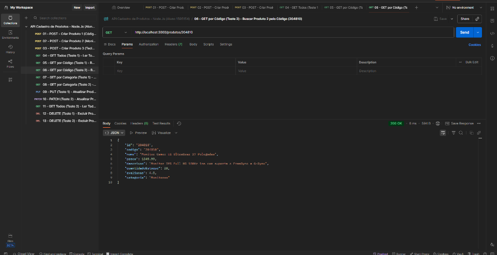
Consulta GET na rota `http://localhost:3000/produtos/204810` para buscar o segundo produto pelo código. O retorno foi 200 OK trazendo somente os dados do Monitor LG.

## 4. Rota GET por categoria

**Teste 1 - Busca pela categoria Informatica**
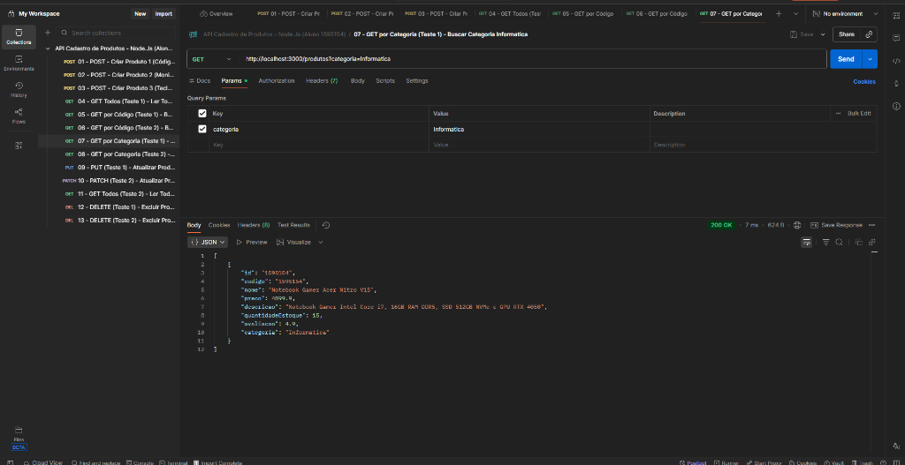
Requisição GET em `http://localhost:3000/produtos?categoria=Informatica` filtrando os produtos pela categoria Informatica. O retorno foi 200 OK trazendo o produto de código `1595154`.

**Teste 2 - Busca pela categoria Monitores**
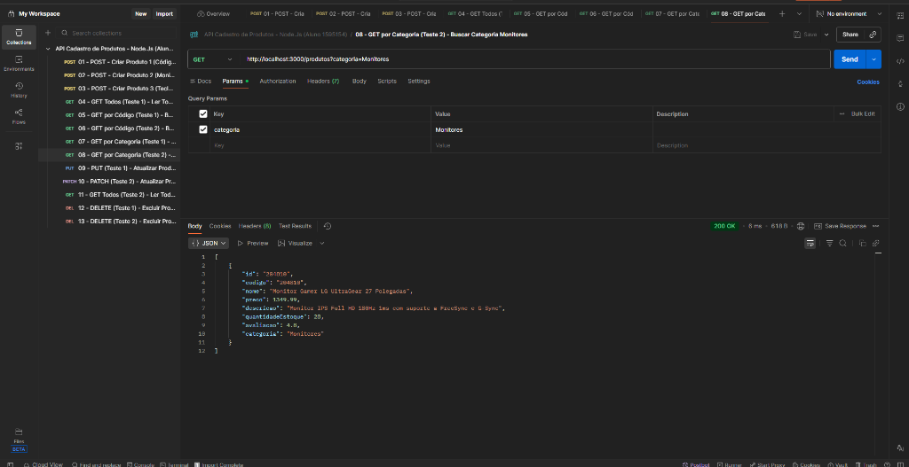
Requisição GET em `http://localhost:3000/produtos?categoria=Monitores` para listar os itens da categoria Monitores. A API retornou 200 OK apenas com o monitor cadastrado (código `204810`).

## 5. Rota PUT e PATCH (Atualização de dados)

**Teste 1 - Atualização com PUT no produto 1595154**

Usando o método PUT em `http://localhost:3000/produtos/1595154`, foram atualizados os dados do primeiro produto (mudando o preço para 4599.9, estoque para 12, avaliação para 5 e descrição). O retorno foi 200 OK com os dados já alterados.

**Teste 2 - Atualização com PATCH no produto 204810**
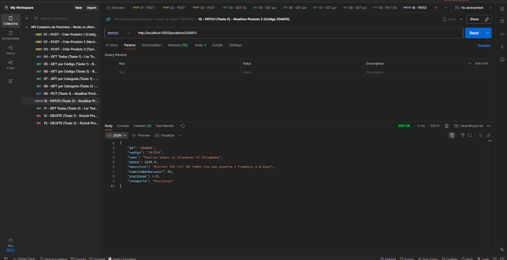
Usando o método PATCH em `http://localhost:3000/produtos/204810`, foram alterados o preço (1249.9), a quantidade em estoque (35) e a avaliação (4.9) do segundo produto, mantendo o resto igual e retornando 200 OK.

## 6. Rota DELETE (Exclusão de produtos)

**Teste 1 - Exclusão do produto 204810**
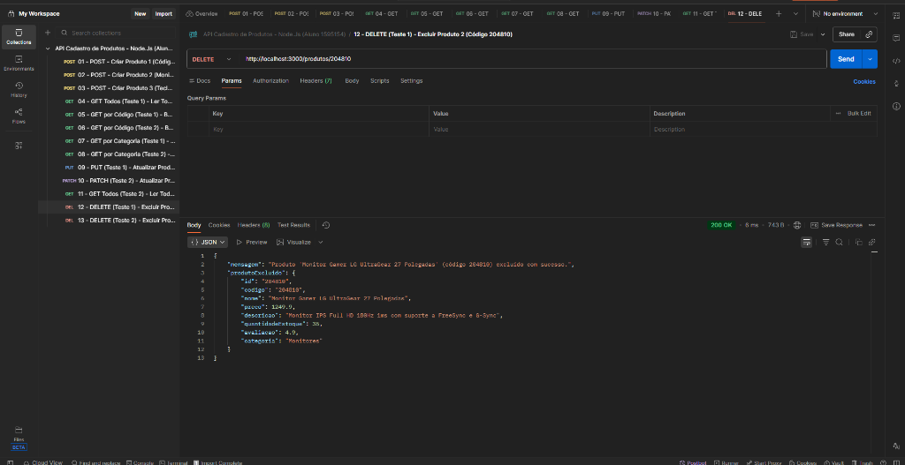
Requisição DELETE na rota `http://localhost:3000/produtos/204810` para apagar o segundo produto do banco. A API removeu o item e retornou 200 OK com a mensagem confirmando a exclusão.

**Teste 2 - Exclusão do produto 309120**
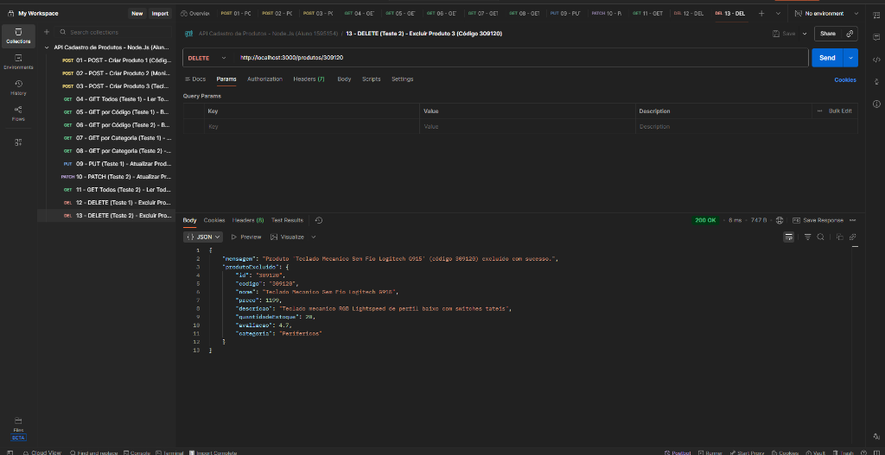
Requisição DELETE na rota `http://localhost:3000/produtos/309120` para excluir o terceiro produto. A API retornou 200 OK confirmando a remoção, deixando o produto com meu código (`1595154`) salvo no banco.
